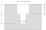
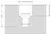
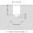

#####
Holes
#####

build123d has four hole objects, one for each common way of drilling a hole for
a fastener. Each one is a part object whose ``mode`` defaults to
``Mode.SUBTRACT``: it removes a solid of revolution from the part at every active
location.

The section above is of this plate:

.. literalinclude:: holes.py
    :language: build123d
    :start-after: [Hole types]
    :end-before: [Hole types]

* :class:`~objects_part.Hole`: a plain cylindrical hole, as a twist drill leaves it.
* :class:`~objects_part.CounterSinkHole`: a hole whose mouth is opened into a cone,
  so a flat-head screw sits flush with the surface.
* :class:`~objects_part.CounterBoreHole`: a hole under a wider, flat-bottomed bore,
  so a socket-head screw sits below the surface.
* :class:`~objects_part.CounterDrillHole`: a counterbore made with a drill instead
  of a flat-bottomed cutter, so the step down to the hole is the cone left by the
  larger drill's point.

Placing holes
-------------

A hole is drilled along the negative Z axis of each location, starting at the
location's origin. A face used as a location has its Z axis along the face's
normal, so a hole placed on a face goes into the part:

.. code-block:: build123d

    with BuildPart() as plate:
        Box(80, 40, 10)
        with Locations(plate.faces().sort_by(Axis.Z)[-1]):
            with GridLocations(60, 20, 2, 2):
                CounterBoreHole(radius=3, counter_bore_radius=5.5, counter_bore_depth=3)

``depth`` is measured from the location along the hole's axis. Without a
``depth`` the hole goes through the part: its length is worked out from the size
of the builder's part, so a through hole needs a builder. In Algebra mode, give
the depth and subtract the hole from a part placed with its top face on the XY
plane:

.. code-block:: build123d

    block = Box(30, 30, 10, align=(Align.CENTER, Align.CENTER, Align.MAX))
    block -= Pos(5, 5) * Hole(radius=3, depth=10)

Dimensions
----------

The sections below are of a single blind hole of each kind, dimensioned with the
arguments that set it.

Hole
^^^^

.. literalinclude:: holes.py
    :language: build123d
    :start-after: [Hole]
    :end-before: [Hole]

CounterSinkHole
^^^^^^^^^^^^^^^

``counter_sink_radius`` is the radius of the cone where it meets the surface, and
``counter_sink_angle`` its included angle, 82° by default as for an inch flat-head
screw; metric (ISO) heads take 90°. ``depth`` is measured from the surface, through the cone.

.. literalinclude:: holes.py
    :language: build123d
    :start-after: [CounterSinkHole]
    :end-before: [CounterSinkHole]

CounterBoreHole
^^^^^^^^^^^^^^^

Both ``counter_bore_depth`` and ``depth`` are measured from the surface.

.. literalinclude:: holes.py
    :language: build123d
    :start-after: [CounterBoreHole]
    :end-before: [CounterBoreHole]

CounterDrillHole
^^^^^^^^^^^^^^^^

``counter_drill_depth`` is measured to the end of the larger drill's full
diameter, as a ``C'DRILL ⌀ ↧ × angle`` callout gives it. The cone below it has
the included angle ``counter_drill_angle``, 118° by default for a standard twist
drill. A blind hole must reach past that cone.

.. literalinclude:: holes.py
    :language: build123d
    :start-after: [CounterDrillHole]
    :end-before: [CounterDrillHole]

Drill points
------------

A blind hole made by a twist drill ends in a cone whose included angle is the
drill's point angle, 118° for a standard drill. Giving ``point_angle`` to any of
the four holes adds that cone below the hole; without it, the bottom stays flat.
As on a drawing, ``depth`` is measured to the end of the full diameter, so the
cone adds ``radius / tan(point_angle / 2)`` below it. A drill point needs a
``depth``, because a through hole has no bottom.

.. literalinclude:: holes.py
    :language: build123d
    :start-after: [Drill point]
    :end-before: [Drill point]

The drawings on this page are made by ``docs/holes.py``.

Reference
---------

* :class:`~objects_part.Hole`
* :class:`~objects_part.CounterSinkHole`
* :class:`~objects_part.CounterBoreHole`
* :class:`~objects_part.CounterDrillHole`
