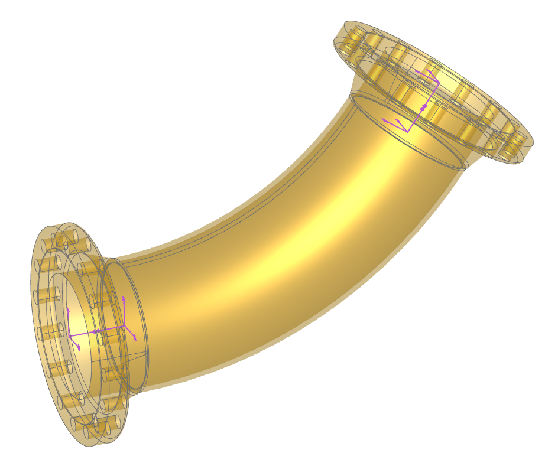
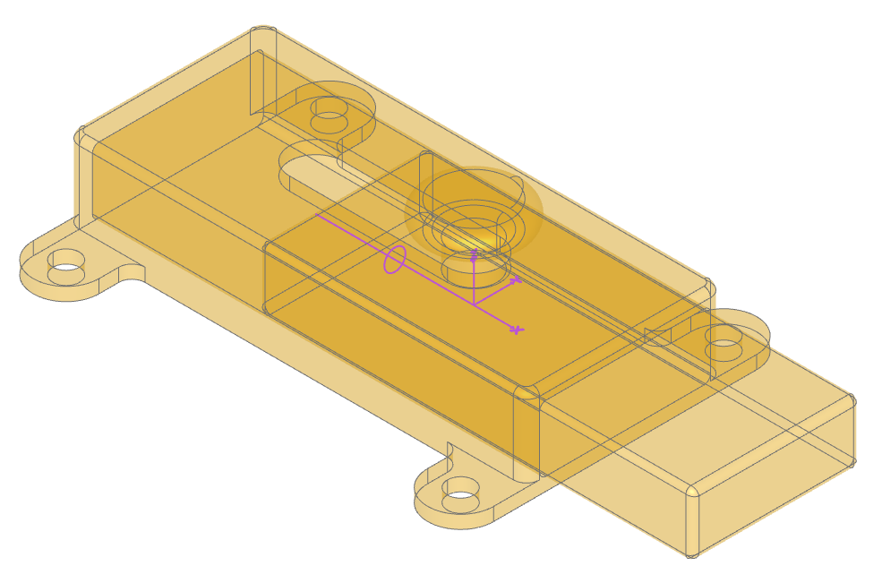
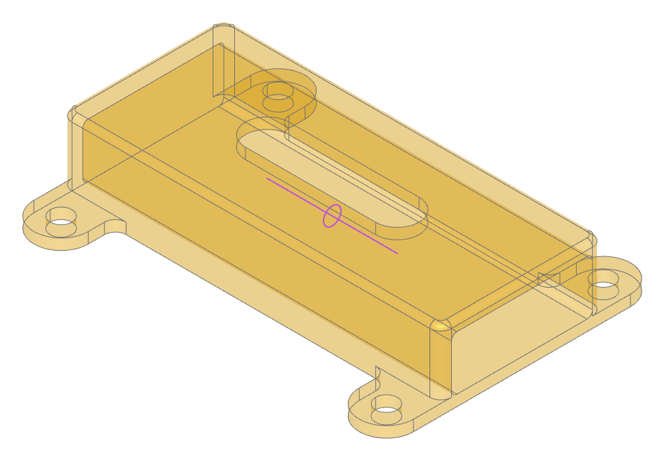
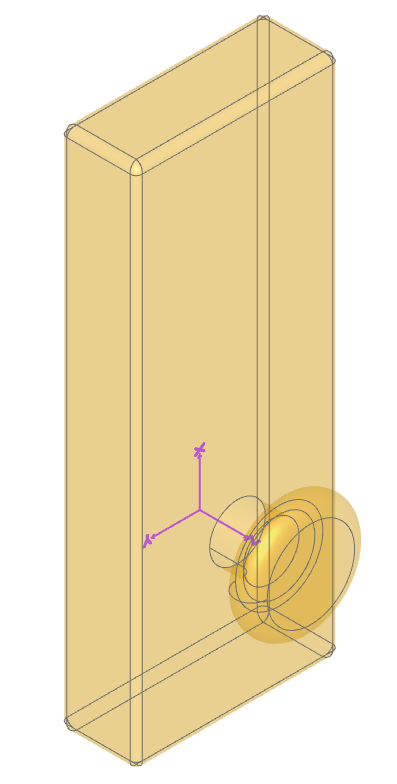
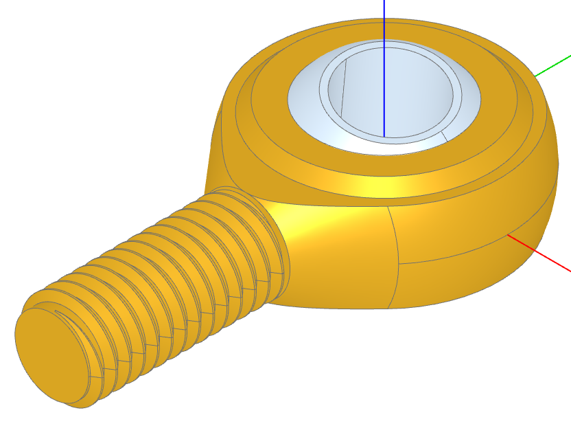

.. _joints:

######
Joints
######

:class:`~topology.Joint`'s enable Solid and Compound objects to be arranged
relative to each other in an intuitive manner - with the same degree of motion
that is found with the equivalent physical joints.  :class:`~topology.Joint`'s always work
in pairs - a :class:`~topology.Joint` can only be connected to another :class:`~topology.Joint` as follows:

+---------------------------------------+---------------------------------------------------------------------+--------------------+
| :class:`~topology.Joint`              | connect_to                                                          | Example            |
+=======================================+=====================================================================+====================+
| :class:`~joints.BallJoint`            |  :class:`~joints.RigidJoint`                                        | Gimbal             |
+---------------------------------------+---------------------------------------------------------------------+--------------------+
| :class:`~joints.CylindricalJoint`     |  :class:`~joints.RigidJoint`                                        | Screw              |
+---------------------------------------+---------------------------------------------------------------------+--------------------+
| :class:`~joints.LinearJoint`          | :class:`~joints.RigidJoint`, :class:`~joints.RevoluteJoint`         | Slider or Pin Slot |
+---------------------------------------+---------------------------------------------------------------------+--------------------+
| :class:`~joints.RevoluteJoint`        | :class:`~joints.RigidJoint`                                         | Hinge              |
+---------------------------------------+---------------------------------------------------------------------+--------------------+
| :class:`~joints.RigidJoint`           | :class:`~joints.RigidJoint`                                         | Fixed              |
+---------------------------------------+---------------------------------------------------------------------+--------------------+

Objects may have many joints bound to them each with an identifying label. All :class:`~topology.Joint`
objects have a ``symbol`` property that can be displayed to help visualize
their position and orientation (the `ocp-vscode <https://github.com/bernhard-42/vscode-ocp-cad-viewer>`_ viewer
has built-in support for displaying joints).

.. note::
    If joints are created within the scope of a :class:`~build_part.BuildPart` builder, the ``to_part``
    parameter need not be specified as the builder will, on exit, automatically transfer the joints created in its
    scope to the part created.

The following sections provide more detail on the available joints and describes how they are used.

.. py:module:: joints

****************
Attaching Joints
****************

A joint is bound to a part in one of three ways. Giving the constructor a ``to_part``
binds it on the spot; constructing it inside a :class:`~build_part.BuildPart` binds it
to the part being built; and a joint made with neither is *free* - it has a location
of its own and no parent - until it is assigned into a part's ``joints`` under its
label, or added to a part with ``+``:

.. code-block:: build123d

    RigidJoint("top", part, Location((0, 0, 5)))               # bound on construction
    part.joints["top"] = RigidJoint(joint_location=Location((0, 0, 5)))  # the same thing
    part += RigidJoint("top", joint_location=Location((0, 0, 5)))        # a new part with the joint

``part.joints`` is a dictionary of the part's joints by label. Assigning a joint to it
binds the joint where it is in the world, so a joint can also be moved from one part
to another this way, and deleting a joint frees it again. The ``+`` form follows the
algebra rules: the operand is untouched and the result is a new part, sharing the
geometry, with copies of the joints.

A free joint can be placed with ``*`` like a shape, which is how joints are made in
bulk in algebra mode: a :class:`~build_common.GridLocations` (or any iterable of
locations) gives one copy per location, with the label suffixed by the location's
index: ``"mount"`` becomes ``mount0``, ``mount1``, ``mount2``, ``mount3``. A label a
part already has raises ``ValueError``; assign to ``part.joints[label]`` to replace a
joint deliberately.

.. code-block:: build123d

    plate = Box(100, 100, 10)
    top = plate.faces().sort_by(Axis.Z)[-1]
    plate -= Plane(top) * GridLocations(60, 60, 2, 2) * Cylinder(5, 10)
    plate += Plane(top) * GridLocations(60, 60, 2, 2) * RigidJoint("mount")
    plate.joints["mount0"]  # ... mount3

In builder mode the same comes from constructing the joint inside a locations
context, alongside the geometry it belongs to:

.. code-block:: build123d

    with BuildPart() as joints_on_holes:
        Box(100, 100, 10)
        with Locations(joints_on_holes.faces().sort_by(Axis.Z)[-1]):
            with GridLocations(60, 60, 2, 2):
                Hole(5)
                RigidJoint("mount")

``label`` may also be a sequence with one label per location, used as given.

Joints follow their part. Moving or rotating a part moves its joints with it, and the
operations that regenerate the geometry - ``mirror``, ``scale``, and ``rotate`` or
``translate`` with ``transform=True`` - transform the joints the same way. A mirrored
joint keeps a right-handed frame: its origin, axis and reference direction are reflected
and the remaining direction recomputed, as :meth:`~geometry.Location.mirror` does, and its
ranges are unchanged. A reflection reverses the sense of every rotation, so a mirrored
hinge at an angle points its reference where the mirror image of the original hinge at
the *negated* angle does; a mirrored slide at a position sits at the mirror image of the
original at that position. Because the frame is rebuilt right-handed rather than
reflected, a part connected to a mirrored joint and offset along the joint's recomputed
axis lands on the opposite side from the reflected original. In a builder, ``mirror`` with
``Mode.ADD`` keeps the original geometry alongside the mirrored copy and leaves the
builder's joints as they are.

***********
Rigid Joint
***********

A rigid joint positions two components relative to each another with no freedom of movement. When a
:class:`~joints.RigidJoint` is instantiated it's assigned a ``label``, a part to bind to (``to_part``),
and a ``joint_location`` which defines both the position and orientation of the joint (see
:class:`~geometry.Location`) - as follows:

.. code-block:: build123d

    RigidJoint(label="outlet", to_part=pipe, joint_location=path.location_at(1))

Once a joint is bound to a part this way, the :meth:`~topology.Joint.connect_to` method can be used to
repositioning another part relative to ``self`` which stay fixed - as follows:

.. code-block:: build123d

    pipe.joints["outlet"].connect_to(flange_outlet.joints["pipe"])

.. note::
    Within a part all of the joint labels must be unique.

The :meth:`~topology.Joint.connect_to` method only does a one time re-position of a part and does not
bind them in any way; however, putting them into an :ref:`assembly` will maintain there relative locations
as will combining parts with boolean operations or within a :class:`~build_part.BuildPart` context.

As a example of creating parts with joints and connecting them together, consider the following code where
flanges are attached to the ends of a curved pipe:

.. literalinclude:: rigid_joints_pipe.py
    :language: build123d
    :emphasize-lines: 19-20, 23-24

Note how the locations of the joints are determined by the :meth:`~topology.Mixin1D.location_at` method
and how the ``-`` negate operator is used to reverse the direction of the location without changing its
position.  Also note that the ``WeldNeckFlange`` class predefines two joints, one at the pipe end and
one at the face end - both of which are shown in the above image (generated by ocp-vscode with the
``render_joints=True`` flag set in the ``show`` function).

.. autoclass:: RigidJoint

..
    :exclude-members: connect_to

    .. method:: connect_to(other: BallJoint, *, angles: RotationLike = None)
    .. method:: connect_to(other: CylindricalJoint, *, position: float = None, angle: float = None)
        :noindex:
    .. method:: connect_to(other: LinearJoint, *, position: float = None)
        :noindex:
    .. method:: connect_to(other: RevoluteJoint, *, angle: float = None)
        :noindex:
    .. method:: connect_to(other: RigidJoint)
        :noindex:

        Connect the ``RigidJoint`` to another Joint.
..

**************
Revolute Joint
**************

Component rotates around axis like a hinge. The :ref:`joint_tutorial` covers Revolute Joints in detail.

During instantiation of a :class:`~joints.RevoluteJoint` there are three parameters not present with
Rigid Joints: ``axis``, ``angle_reference``, and ``range`` that allow the circular motion to be fully
defined.

When :meth:`~topology.Joint.connect_to` with a Revolute Joint, an extra ``angle`` parameter is present
which allows one to change the relative position of joined parts by changing a single value.

.. autoclass:: RevoluteJoint

..
    :exclude-members: connect_to

    .. method:: connect_to(other: RigidJoint, *, angle: float = None)

        Connect the ``RevoluteJoint`` to a ``RigidJoint``

************
Linear Joint
************

Component moves along a single axis as with a sliding latch shown here:

The code to generate these components follows:

.. literalinclude:: slide_latch.py
    :language: build123d
    :emphasize-lines: 30, 52, 55

Note how the slide is constructed in a different orientation than the direction of motion. The
three highlighted lines of code show how the joints are created and connected together:

* The :class:`~joints.LinearJoint` has an axis and limits of movement
* The :class:`~joints.RigidJoint` has a single location, orientated such that the knob will ultimately be "up"
* The ``connect_to`` specifies a position that must be within the predefined limits.

The slider can be moved back and forth by just changing the ``position`` value.  Values outside
of the limits will raise an exception.

.. autoclass:: LinearJoint

..
    :exclude-members: connect_to

    .. method:: connect_to(other: RevoluteJoint, *, position: float = None, angle: float = None)
    .. method:: connect_to(other: RigidJoint, *, position: float = None)
        :noindex:

        Connect the ``LinearJoint`` to either a ``RevoluteJoint`` or ``RigidJoint``

*****************
Cylindrical Joint
*****************

A :class:`~joints.CylindricalJoint` allows a component to rotate around and moves along a single axis
like a screw combining the functionality of a :class:`~joints.LinearJoint` and a
:class:`~joints.RevoluteJoint` joint.  The ``connect_to`` for these joints have both ``position`` and
``angle`` parameters as shown below extracted from the joint tutorial.

.. code-block::python

    hinge_outer.joints["hole2"].connect_to(m6_joint, position=5 * MM, angle=30)

.. autoclass:: CylindricalJoint

..
    :exclude-members: connect_to

    .. method:: connect_to(other: RigidJoint, *, position: float = None, angle: float = None)

        Connect the ``CylindricalJoint`` to a ``RigidJoint``

**********
Ball Joint
**********

A component rotates around all 3 axes using a gimbal system (3 nested rotations). A :class:`~joints.BallJoint`
is found within a rod end as shown here:

.. literalinclude:: rod_end.py
    :language: build123d
    :emphasize-lines: 40-44,51,53

Note how limits are defined during the instantiation of the ball joint when ensures that the pin or bolt
within the rod end does not interfere with the rod end itself. The ``connect_to`` sets the three angles
(only two are significant in this example).

.. autoclass:: BallJoint

..
    :exclude-members: connect_to

    .. method:: connect_to(other: RigidJoint, *, angles: RotationLike = None)

        Connect a ``BallJoint`` to a ``RigidJoint``
