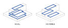

.. _projection:

##########
Projection
##########

Projection carries geometry from one place to another along a direction: a
part's outline onto a drawing sheet, a label onto a curved surface, a path
onto the ground beneath it. build123d has three projections, told apart by
what they project onto and what comes back.

.. list-table::
    :header-rows: 1
    :widths: 24 30 46

    * - Operation
      - Onto
      - Result
    * - :func:`~operations_generic.project_to_plane`
      - a plane
      - the same kind of thing, flat: a sketch of faces, a curve of edges, or
        points, in the plane's own coordinates
    * - :func:`~operations_part.project_to_shape`
      - the surface of a shape
      - the same kind of thing, lying on that surface, ready to extrude or
        follow
    * - :meth:`~topology.Mixin1D.drawing_view`
      - a drawing, from a viewpoint
      - always edges, split into visible and hidden

The first two keep the dimension of their input and are operations in both
Builder and Algebra mode. The third is a method of edges, wires, faces,
solids and compounds and is the basis of technical drawings.

.. code-block:: build123d

    with BuildPart() as badge:
        Cylinder(20, 4)
        with BuildSketch(Plane.XY.offset(10)):
            Text("b3d", 12)
        project_to_shape()  # the letters land on the top of the badge
        extrude(amount=-0.5, mode=Mode.SUBTRACT)

**********
Operations
**********

.. grid:: 1 2 2 2
    :gutter: 3

    .. grid-item-card:: Onto a plane
        :link: projection_plane
        :link-type: ref

        ``project_to_plane``: bring faces, edges, points or a solid's
        silhouette into a sketch or a line.

    .. grid-item-card:: Onto a shape
        :link: projection_shape
        :link-type: ref

        ``project_to_shape``: cast a sketch onto a part's surface, choosing
        which of the surfaces it meets to keep.

    .. grid-item-card:: A drawing view
        :link: projection_view
        :link-type: ref

        ``drawing_view``: the visible and hidden edges of a part from a viewpoint,
        for an SVG or DXF drawing.

    .. grid-item-card:: Faces along a path
        :link: projection_faces
        :link-type: ref

        ``wrap_faces`` and ``project_faces``: a row of letters laid along a
        curve on a surface.

.. grid:: 1 2 2 2
    :gutter: 3

    .. grid-item-card:: Reference
        :link: projection_reference
        :link-type: ref

        Every signature, the ``Hit`` enum and ``DrawingViewOutput``.

.. toctree::
    :hidden:

    plane
    shape
    view
    faces
    reference
