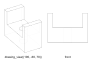

.. _projection_view:

##############
A drawing view
##############

``drawing_view`` is the projection that makes a drawing: the edges of a shape as
seen from a viewpoint, split by hidden-line removal into those in sight and
those behind the shape's own surface. Whatever it is given, a solid, a
compound of parts or a single face, it returns edges.

.. literalinclude:: ../projection_examples.py
    :language: build123d
    :start-after: [view_basic]
    :end-before: [view_basic]

The ``viewpoint`` is where the view is taken from and ``up`` which way the
drawing's y axis runs, ``(0, 0, 1)`` unless said otherwise. The view looks
at the shape's centre, or at ``look_at``. Without ``focus`` the view is
orthographic, the drawing kind; with a focal length it is a perspective
view. The result is a :class:`~topology.DrawingViewOutput` named tuple that
unpacks into ``visible, hidden`` and also answers by name.

Each line of the drawing comes back once. Hidden-line removal can return the
same line more than once, for instance where unfused parts of a compound meet
or where a hidden edge lies directly under a visible one, so ``drawing_view``
drops edges that lie on a visible edge and merges edges that lie on the same
curve and touch or overlap, such as the pieces of an edge split where another
crosses it in the view. A hidden line drawn dashed then never overprints a
solid one.

*****************
Making a drawing
*****************

The edges lie in the plane of the view and go straight into the SVG or DXF
exporters, hidden lines on their own layer so they can be dotted.

.. literalinclude:: ../projection_examples.py
    :language: build123d
    :start-after: [view_export]
    :end-before: [view_export]

The :ref:`technical drawing tutorial <tech_drawing_tutorial>` places several
views of a part on a page with a title block, and
:class:`~drafting.TechnicalDrawing` draws the frame.

*****
Notes
*****

* ``drawing_view`` was ``project_to_viewport``; the old name, with ``viewport_origin``
  and ``viewport_up``, works for one release with a deprecation warning.
* A silhouette on a plane for a sketch is the job of
  :ref:`project_to_plane <projection_plane>` given a solid; ``drawing_view`` gives the edges of
  the drawing, not a face.
