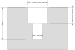
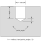

#####
Holes
#####

build123d provides three hole objects. Each uses ``Mode.SUBTRACT`` by default
to cut a hole at every active location.

* :class:`~objects_part.Hole` cuts a cylindrical bore.
* :class:`~objects_part.CounterSinkHole` adds a conical recess for a flat-head screw.
* :class:`~objects_part.CounterBoreHole` adds a flat-bottomed recess for a
  socket-head screw.

.. literalinclude:: holes.py
    :language: build123d
    :start-after: [Hole types]
    :end-before: [Hole types]

Placing holes
-------------

A hole runs from its location's origin along the local negative Z axis. When
you use a planar face as the location, positive Z follows the face normal and
the hole cuts into the part.

.. code-block:: build123d

    with BuildPart() as plate:
        Box(80, 40, 10)
        with Locations(plate.faces().sort_by(Axis.Z)[-1]):
            with GridLocations(60, 20, 2, 2):
                CounterBoreHole(radius=3, counter_bore_radius=5.5, counter_bore_depth=3)

In Builder mode, omit ``depth`` to size a through hole from the existing part.
In Algebra mode, set ``depth`` explicitly and subtract the cutter. Here the top
face is at Z = 0, so a depth of 10 cuts through the block.

.. code-block:: build123d

    block = Box(30, 30, 10, align=(Align.CENTER, Align.CENTER, Align.MAX))
    block -= Pos(5, 5) * Hole(radius=3, depth=10)

Dimensions
----------

The drawings show how each argument sets the dimensions of a blind hole.

Hole
^^^^

.. literalinclude:: holes.py
    :language: build123d
    :start-after: [Hole]
    :end-before: [Hole]

CounterSinkHole
^^^^^^^^^^^^^^^

``counter_sink_radius`` sets the opening radius. Set ``counter_sink_angle`` to
the screw head's included angle. The default is 82°, common for inch flat-head
screws. Many metric flat-head screws use 90°. ``depth`` starts at the surface
and includes the recess.

.. literalinclude:: holes.py
    :language: build123d
    :start-after: [CounterSinkHole]
    :end-before: [CounterSinkHole]

CounterBoreHole
^^^^^^^^^^^^^^^

Measure ``counter_bore_depth`` from the surface to the flat shoulder. Measure
``depth`` from the same surface to the bottom of the bore.

.. literalinclude:: holes.py
    :language: build123d
    :start-after: [CounterBoreHole]
    :end-before: [CounterBoreHole]

Counterdrill
------------

build123d has no dedicated counterdrill object. A
:class:`~objects_part.CounterSinkHole` placed below the surface forms the
conical shoulder. See :ref:`model_a_counterdrill` for through and blind examples.

Drill points
------------

Set ``point_angle`` on any of the three hole objects to give a blind hole a
conical bottom. Use an included angle in degrees, strictly between 0° and 180°.
Omit ``point_angle`` for a flat bottom.

Give an explicit ``depth`` from the location to where the cylindrical bore
ends. The tip extends another ``radius / tan(point_angle / 2)`` beyond that
depth. The example uses a common twist-drill angle of 118°.

.. literalinclude:: holes.py
    :language: build123d
    :start-after: [Drill point]
    :end-before: [Drill point]

``docs/reference/holes.py`` generates the drawings on this page.
